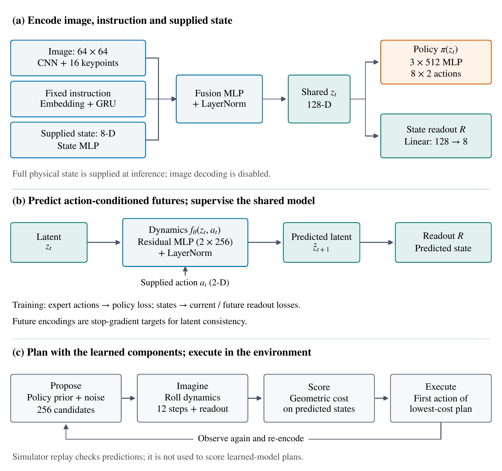

<div align="center">

# pico-WAM

**A compact World Action Model for understanding how acting and predicting interact.**

</div>

pico-WAM combines a policy, action-conditioned dynamics and a state readout around
one shared representation. You can trace a decision from an observation through
imagined consequences to an executed action, then check those consequences in a
simulator. The project is intended for teaching, inspection and reproducible research.

The main task is **Push-T**: a blue disk pushes a T-shaped block onto a target.
Training starts from the 206 human demonstrations in LeRobot's
[Push-T dataset](https://huggingface.co/datasets/lerobot/pusht), with block poses
reconstructed from its [keypoint companion](https://huggingface.co/datasets/lerobot/pusht_keypoints).
The architecture extends [mini-VLA](https://github.com/keivalya/mini-vla) with a world
model and an external planner.

<div align="center">
  
  <br>
  <em>A historical teaching visualization from an earlier training recipe. Predicted
  states are rendered as frames. This illustration is not an outcome from the current
  paper's controlled study, which disables image decoding.</em>
</div>

## Start here

| Your goal | First command or guide |
|---|---|
| Learn the complete pipeline on a CPU | `python -m examples.quickstart` |
| Understand the architecture and losses | [Teaching guide](docs/TEACHING.md) |
| Regenerate paper figures and numerical summaries | `python reproduce.py figures` |
| Replay the paper's worked decision | `python reproduce.py trace` |
| Check the complete miniature workflow | `python reproduce.py check` |
| Retrain the full paper experiments | [Reproduction guide](docs/REPRODUCING.md) |
| Understand what has actually been verified | [Validation record](docs/VALIDATION.md) |

## What the current study finds

The manuscript, *pico-WAM: Evaluating Counterfactual Prediction and Planning Error
in a Compact World Action Model*, studies a supplied-state setting with a constant
instruction. It does not evaluate visual-only control or language generalization.
This repository contains the code and numerical evidence; the manuscript and its
development history are maintained separately. A publication link will be added
when available.

The main Push-T study uses **15 training seeds**, matched initialization and action
minibatches, 30,000 updates per condition, and 200 paired final starts per seed.

- **Data coverage changes what a model can rank.** Adding simulator branches lowers
  selected-plan regret from 7.56 to 2.77 cost units on a shared candidate bank.
  That cost includes both block-goal distance and agent approach; lower regret need
  not mean immediate block movement.
- **Branches enlarge an existing restart advantage.** Restarting search from the
  policy wins with both datasets. Branches increase its coverage advantage over
  warm search from 22.5 to 27.3 percentage points: a 4.8-point interaction, with
  an original paired 95% interval of 1.5–8.0.
- **Changing scores helps with learned proposals retained.** Replacing predicted
  candidate scores with simulator costs improves coverage by 12.2 points
  [9.4, 15.0]. Replacing the proposal pipeline alone shows no detected gain.
- **Better prediction and ranking do not establish superiority over imitation.**
  The learned planner shows no detected coverage advantage over BC in the matched
  study. Tuned imitation and Diffusion Policy provide further controls. Some of
  these comparisons are exploratory and Diffusion Policy has five training seeds.
- **A second task tests a narrower mechanism.** Broader data also improves cost
  ranking in Meta-World door opening. That experiment uses separate state-space
  networks, not a transfer of the shared pico-WAM architecture.

Intervals use paired training-run differences, not candidate states or episodes as
independent trained models. Secondary intervals are unadjusted. The archived
reports retain per-run outcomes and primary/secondary/exploratory labels.

## How pico-WAM is built



An observation consists of a 64×64 image, instruction tokens and physical state.
For Push-T, state has eight coordinates: agent position and velocity, block position,
and block orientation as cosine/sine.

| Component | Role | Implementation |
|---|---|---|
| Encoders | Image CNN with 16 spatial-softmax keypoints, instruction GRU, state MLP | [encoders.py](models/encoders.py) |
| Fusion | Produce the shared 128-dimensional latent `z_t` | [fusion.py](models/fusion.py) |
| Policy | Predict a chunk of eight 2-D actions; main head has three 512-unit layers | [action_heads.py](models/action_heads.py) |
| Dynamics | Advance the latent using a residual action-conditioned MLP | [dynamics_head.py](models/dynamics_head.py) |
| State readout | Map encoded or imagined latents to standardized physical state | [dynamics_head.py](models/dynamics_head.py) |
| Optional image readout | Decode latents for teaching experiments; disabled in the controlled paper study | [image_decoder.py](models/image_decoder.py) |
| Training objectives | Action imitation, current/future state, latent consistency and optional image losses | [losses.py](models/losses.py) |
| Complete model | Encoding, action sampling and imagined rollouts | [wam_policy.py](models/wam_policy.py) |

The transition is `z_next = LayerNorm(z + MLP([z, action]))`. The state-based paper
objective is action MSE + 0.5 × (current-state MSE + future-state MSE) + latent MSE.
Future latent targets are encoded observations with their gradients stopped.
State normalization comes only from training demonstrations.

The model can act in two ways. A **reactive policy** executes four actions from each
eight-action chunk before observing again. A **planner** imagines 256 candidate
sequences over 12 steps, scores their predicted states with a known geometric cost,
and executes one action before replanning. Main learned-model planning uses no
simulator queries for selection. Explicit exact-simulator diagnostics do.

The planner's candidate bank contains its center, the policy proposal and 254 noisy
perturbations. Restart centers on the current policy proposal; warm search shifts
the previous selected plan. The two explicit candidates coincide at restart.

## Installation

Use Python **3.11**. From the repository root:

```sh
git clone https://github.com/keivalya/pico-wam.git
cd pico-wam
python3.11 -m venv .venv
. .venv/bin/activate
python -m pip install -r requirements.txt
```

The initial repository is private during release preparation, so cloning requires
access. The CPU examples need no cluster, GPU, MuJoCo or external dataset download.
The direct dependency versions were tested on Python 3.11.9/macOS arm64; complete
tested environment records are under [requirements/](requirements/).

For the optional Diffusion Policy and door-study workflows:

```sh
python -m pip install -r requirements/paper-extras.txt
```

Original gym-pusht requires a **separate environment** because version 0.1.8 needs
Pymunk 6, while the main workflow uses Pymunk 7:

```sh
python3.11 -m venv .venv-original
. .venv-original/bin/activate
python -m pip install -r requirements/original-physics.txt
```

Reactivate `.venv` for the quickstart and figure/trace workflows.
`.venv-original` is only for the original-physics adapter.

The original GPU research environments are recorded separately in
[reproduction/environments/](reproduction/environments/). The current tested CPU
environment is not a claim of bitwise equivalence to those training environments.

## A complete CPU example

```sh
python -m examples.quickstart
```

This collects 12 short point-mass episodes, trains a small WAM for two epochs, checks
predictions and runs two short reactive episodes. Data, weights and diagnostics go
into `outputs/quickstart/`. The example refuses to overwrite an existing directory;
use `--output outputs/another-example` for a separate run.

It teaches the pipeline, not benchmark performance. Its six-dimensional state,
short training and task differ from the paper's Push-T protocol. Inspect the saved
checkpoint and diagnostics, then read [the teaching guide](docs/TEACHING.md).

## Get the Push-T demonstrations

```sh
python -m scripts.download_pusht --output-path data/pusht.npz
python -m scripts.branch_demos data/pusht.npz \
  --output-path data/pusht_branches.npz \
  --every 4 --length 8 --noise 0.3 --seed 271828
```

The downloader pins both LeRobot repositories to full revisions. Downloading videos,
converting frames and storing image arrays requires network access and several GB
of free space. Files are not bundled or redistributed here.

The conversion contains 25,444 transitions. None of the source demonstrations reaches
the >95% overlap success threshold; mean maximum recorded coverage is 84.8%.
Branches add 6,013 short sequences containing 48,104 transitions. They inherit the
source episode's split and never provide expert imitation labels.

The headless simulator retains the original geometry and physics constants but uses
relative actions and resets block velocity each control step. This supports exact
state/action replay. The paper separately checks original gym-pusht physics through
an adapter; these adapted scores should not be equated with published visual benchmarks.

## Train and inspect a teaching model

```sh
python -m scripts.train \
  --dataset-path data/pusht_branches.npz \
  --model_type wam --action_head mlp --predict_state \
  --horizon 5 --action-chunk 8 \
  --policy-hidden 512 --policy-layers 3 \
  --epochs 20 --seed 10 --device auto \
  --save-path outputs/tutorial/wam.pt
```

This is a convenient tutorial recipe. It is **not** the paper's matched fixed-update
experiment, which uses separate action/auxiliary batches and a three-way episode
split. Use `scripts.evidence_study` and the configuration below for that experiment.

To train action-only BC through this tutorial interface, use demonstration-only
data, `--model_type vla`, and omit `--predict_state`. The optional image decoder is
enabled with `--predict_image`; `--image-focus 10` gives extra weight to moving
pixels. Decoder experiments are outside the controlled paper recipe.

```sh
python -m scripts.test --checkpoint outputs/tutorial/wam.pt \
  --planner mpc --episodes 20 --device cpu --json-out outputs/tutorial/control.json
python -m scripts.evaluate --checkpoint outputs/tutorial/wam.pt --device cpu
python -m scripts.visualize_rollout --checkpoint outputs/tutorial/wam.pt --video --gif
```

Use `--planner policy` for reactive execution. `--device auto` in training selects an
available accelerator; the commands also support explicit CPU execution. Each module's
`--help` lists its options. Use new output paths for experiments you want to preserve.

## Reproduce the paper

There are three distinct levels of reproduction:

```sh
python reproduce.py verify       # Check source/config/report hashes.
python reproduce.py figures      # Regenerate eight figures and numerical summaries.
python reproduce.py trace        # Replay the saved Fig. 1 actions and inspect predictions.
python reproduce.py sensitivity  # Retrospective run-influence/bootstrap checks.
python reproduce.py smoke        # Tiny matched study and four-cell planning pipeline.
python reproduce.py check        # Run all of the above.
```

Outputs go to `reproduction/generated/`. Figure regeneration compares ten numerical
outputs exactly with archived references after removing old output copies. PDF bytes
may vary with fonts, rendering libraries and metadata.

The trace reads saved neural predictions and verifies simulator replay. It does not
recreate neural predictions without the original checkpoints. The miniature workflow
uses abbreviated training and synthetic data; its numbers are software checks.
Retrospective sensitivity checks reuse the original paired runs and do not replace
the original primary analyses.

Full retraining begins with:

```sh
python -m scripts.evidence_study prepare \
  --config experiments/ral_evidence_v2.json \
  --demos data/pusht.npz --branches data/pusht_branches.npz \
  --study results/ral-evidence-v2
```

Follow [the full reproduction guide](docs/REPRODUCING.md) for all seeds and methods,
development evaluations, freezing, final evaluations and dependent studies. The
main configuration fixes 15 seeds and 30,000 updates; the earlier five-seed config
is retained only because the miniature tests exercise its protocol schema.

| Evidence | Configuration / entry point |
|---|---|
| Main data × search interaction | `experiments/ral_evidence_v2.json`; `scripts.evidence_study` |
| Candidate ranking | `experiments/f1_candidate_ranking.json`; `scripts.candidate_audit` |
| Horizon-matched training | `experiments/ral_evidence_f0.json`; `scripts.evidence_study` |
| Architecture variants | `experiments/architecture_v1.json`; `followup.architecture` |
| Tuned BC / Diffusion Policy | `experiments/s3a_history_bc.json`, `s3b_diffusion_policy.json`; `followup.study` |
| State / exact dynamics | `experiments/s4_planners.json`; `followup.study` |
| Original physics / fresh prediction | `followup.original_pusht`, `followup.fresh_prediction` |
| Crossed proposal/scoring intervention | `experiments/tmlr_factorial_v1.json`; `followup.tmlr_factorial` |
| Independent door mechanism | `experiments/tmlr_contact_v1.json`; `followup.tmlr_contact` |

Main-study work including checks used 21.3 V100 GPU-hours. Horizon-matched training
used 16.0, architecture variants 16.9 and Diffusion Policy 44.7 GPU-hours. The dynamics
study used 1,390 allocated CPU-hours including reruns. These measurements are not
the runtime of the quickstart or a complete project compute total.

## Scope and interpretation

- Full physical state is supplied at inference in the controlled Push-T study.
  The instruction is fixed and image decoding is disabled.
- Simulator branching changes both state and action coverage. It requires simulator
  access and is not a hardware data-collection method.
- Ranking regret uses a known surrogate cost. Its improvement has not been decomposed
  into block-goal and agent-approach terms.
- Reactive and planning controllers observe at different frequencies. The primary
  warm/restart and scoring comparisons hold that frequency fixed.
- Original-physics evaluation checks separate contrasts, not the full data/search
  interaction. Door opening uses a different architecture and fixed data/banks.
- Archived-report regeneration and small integration checks do not establish full
  independent numerical reproduction. No original pretrained checkpoints are included.

## Repository layout

```text
models/          Shared representation, policy, dynamics and readouts
envs/            Push-T, point-mass and optional simulator adapters
scripts/         Data conversion, tutorial training and matched-study tools
followup/        Paper interventions and imitation controls
experiments/     Frozen study configurations
examples/        Small executable teaching example
tests/           Protocol, model and integration checks
reproduction/    Archived reports, reference numbers, generators and input manifest
requirements/    Optional dependencies and tested/original environment records
docs/            Teaching, full reproduction and verification guides
```

This standalone export has fresh history. `SOURCE_PROVENANCE.json` records the
development source revision and file mapping; original numerical reports are
preserved. Future edits to code/configuration require a new study registration.
To deliberately refresh the release input manifest after development, run
`python -m scripts.make_manifest`, then rerun the checks before publishing.

## Citation and license

Use [CITATION.cff](CITATION.cff) to cite software version 0.1.0. Publication metadata
will be added when the manuscript is public; no publication or acceptance is implied.

MIT license, copyright Keivalya Pandya. Vendored Diffusion Policy code retains its
[upstream MIT license](followup/vendor/diffusion_policy/LICENSE), authorship and pinned
source reference. Downloaded datasets and simulator packages retain their own licenses.
