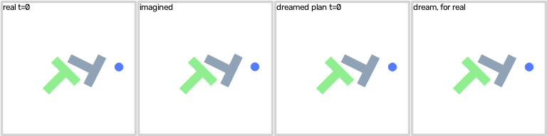

<div align="center">

# pico-WAM

</div>

pico-WAM is a compact World Action Model (WAM): a model of about a million parameters for studying how a robot policy and a world model interact. One shared latent state feeds a policy, an action-conditioned transition model, and state and image readouts, so the same model both acts and predicts how the world will change.

Its example task is **Push-T**, the benchmark from [Diffusion Policy](https://diffusion-policy.cs.columbia.edu/): a blue disk has to push a grey T-shaped block until it covers the green target. pico-WAM learns it from the 206 human demonstrations of LeRobot's [Push-T dataset](https://huggingface.co/datasets/lerobot/pusht).

> [!IMPORTANT]
> pico-WAM is a research and teaching implementation, not a production system. A VLA learns `image_t + language + state_t → action_t`; pico-WAM learns `image_t + language + state_t → action_t + state_t+1 + image_t+1`. (Inspired by, and extending, [mini-VLA](https://github.com/keivalya/mini-vla).)

<div align="center">
  
  <br>
  <em>The final pico-WAM model on an unseen human demonstration. Real: the person's episode. Imagined: what pico-WAM predicts from the first frame alone, given the person's actions. Dreamed: its own policy choosing every action inside its imagination; like the planner, it looks at the world again every 12 steps, since a dream stays accurate for about that long. Dream, for real: the same dreamed actions played in the simulator, the fair check of the dream. Frames are drawn from the states the model imagines.</em>
</div>

The codebase is intentionally small (the whole model package is under 1,000 lines) so that,
- beginners coming from VLAs can follow the complete WAM training and prediction pipeline
- researchers can quickly prototype ideas around latent world models
- students can *look inside* a world model: decode its predictions, ask "what if I pushed left?", and check them against the true simulator

> [!TIP]
> Start with the paper. It describes the design and every experiment in this repository.
> - **pico-WAM: Design and Evaluation of a Compact World Action Model** ([PDF](docs/paper/pico-wam-paper.pdf), [LaTeX source](docs/paper/pico-wam-paper.tex))
> - [Research plan](docs/paper/RESEARCH_PLAN.md): open questions, confounds, and next experiments
> - [Hands-on tutorial](docs/pico-wam-paper.md): the Push-T study explained step by step, for readers coming from VLAs
> - Blog: From VLAs to WAMs (Math, Code, and Intuition), **TBD**

This project is not meant to be state-of-the-art. The architecture uses established components; the contribution is a clear, hackable implementation and a controlled study of how its parts behave.

## What the paper finds

The paper studies pico-WAM in two environments whose simulators can replay any alternative action, so every prediction, including predictions under actions nobody took, can be checked against the truth: **Push-T**, trained on LeRobot's human demonstrations, and a 2D **point-mass** navigation task with exactly known dynamics. Main comparisons use three independent runs and the supervision pilots five; ± is the standard deviation across runs, and every Push-T policy is tested on 100 unseen starts per run.

On Push-T:

- **Predictions are good along human actions, and poor under new ones.** Fifteen steps ahead, the state error is 0.0178 nMSE, 44× lower than assuming nothing moves. Under pushes people never made, the model predicts the T worse than assuming it stays put: 1.36× that error.
- **Showing the world model other pushes fixes it.** Branching every human demonstration in the simulator, with the human's actions slightly perturbed, brings the T's error down to 0.45× "stays put". Only the world model learns from the branches.
- **Planning with the world model beats the policy, if the search stays close to the policy.** A stronger search makes the model expect 82.1 px of improvement from its plans while the simulator delivers −1.9 px: the planner finds the model's errors. A planner that reuses its last plan drifts the same way over an episode, so the final planner restarts every search from the policy's plan.
- **The action head was the bottleneck.** Widening the policy's head from one hidden layer of 128 to three of 512 is the biggest single improvement. Planning goes from 77 to 121 successes in 300 unseen episodes, and the WAM's own policy from 7 to 85. Wider or deeper heads, and a wider latent, add parameters without helping.
- **Four simple changes make it succeed.** With action chunks, branched data, a planner that restarts from the policy and the 3×512 head, the planning WAM succeeds in 121 of 300 unseen episodes and the behavioral-cloning baseline mini-VLA in 116.
- **Without the state, only the WAM works.** From images and the instruction alone, the WAM succeeds in 46 episodes by planning and 43 on its own; mini-VLA succeeds in 0.
- **It's cheap.** The final WAM has 1.33 million parameters, 0.96 million without its image decoder, which the planner does not need. A planning step, 256 imagined futures of 12 steps, takes 36 ms on one laptop CPU thread, and the whole Push-T study took about 90 GPU-hours.

On the point-mass world:

- **State prediction works, image prediction does not, yet.** Fifteen steps ahead, normalized state error is 0.0071 ± 0.0004, about 80× lower than persistence, while decoded frames are worse than copying the current frame at every horizon.
- **Data coverage matters for "what if" questions.** Expert-only training gives about 15× higher error under random alternative actions than training with random-action bursts (0.112 vs. 0.0072 at 10 steps), even though an affine model recovers the simulator from expert data alone.
- **Supervising the current state does most of the work.** With image inputs, the WAM reaches 80.3 ± 12.0% success against 36.0 ± 19.8% for mini-VLA, but it also receives state targets. A matched pilot gives 17.0% for cloning, 28.4% with current-state supervision and 33.6% with future-state prediction added. On Push-T, the same pilot gives 6.3%, 14.2% and 11.7% best coverage.
- **Image decoding dominates cost.** The decoder holds about half of the 747,739 parameters, and removing it cuts a CPU optimizer step from 2.55 s to 0.27 s.

The paper also places pico-WAM's design choices alongside eight open-source systems (GR-1, UWM, WorldVLA, Genie Envisioner, Cosmos Policy, V-JEPA 2-AC, DreamGen and LingBot-VA) and planners on Push-T (DINO-WM and PILOT), and lists its limitations: privileged state inputs, a hand-written planning cost, branches that need a simulator, and no history-based baseline yet.

## How pico-WAM is built

pico-WAM is a VLA-style policy with a world model trained alongside it. The policy and the transition model share one latent state `z_t`; at deployment, only the policy is used.

- [models/encoders.py](models/encoders.py) encodes the 64×64 image (a three-layer CNN with 16 spatial-softmax keypoints, or a plain pooled CNN), the instruction (a GRU) and the low-dimensional state (an MLP)
- [models/fusion.py](models/fusion.py) fuses them with an MLP and layer norm into a 128-dimensional latent `z_t`
- [models/action_heads.py](models/action_heads.py) turns `z_t` into an action, or a chunk of the next K actions, with an MLP head, three hidden layers of 512 by default; [diffusion](models/diffusion_head.py) and [flow-matching](models/flow_matching_head.py) heads are also included (the paper's control experiments use the MLP head)
- [models/dynamics_head.py](models/dynamics_head.py) holds the transition model, a residual MLP `z_t+1 = LN(z_t + MLP[z_t, a_t])`, and a *linear* `StateReadout` that maps any latent, encoded or predicted, to the physical state
- [models/image_decoder.py](models/image_decoder.py) decodes any latent into an image, predicted as a residual on the training-set mean image
- [models/losses.py](models/losses.py) combines the action, state, image and latent-consistency losses
- [models/wam_policy.py](models/wam_policy.py) puts everything together, including `imagine()` for multi-step rollouts in latent space

Training uses windows of `H = 5` transitions and minimizes `L_act + 0.5 L_state + L_image + L_latent`. The action loss uses only expert-labeled steps; the prediction losses use every transition, including random-action bursts and simulator branches. Dropping the world model and its losses leaves [mini-VLA](https://github.com/keivalya/mini-vla), the small VLA that pico-WAM extends, with the same encoders and action head; it is the behavioral-cloning baseline in every experiment.

The WAM can also act by planning with its own world model ([scripts/plan.py](scripts/plan.py)): at every step it imagines 256 action sequences around its policy's plan, reads the T's predicted pose out of each imagined latent, and executes the first action of the best one. The planner never calls the simulator.

Environments and data:
- [envs/pusht_env.py](envs/pusht_env.py) is Push-T, rebuilt headless with [pymunk](https://www.pymunk.org/) and the original's physics constants, and drawn like the dataset's frames. Two changes suit a world model: an action moves the agent's target up to 100 px from where the agent is (so a random action is a local nudge), and the block's velocity is reset every control step (so the observed state, agent position and velocity plus block pose, fully determines the next one and every prediction can be checked against the simulator). From a recorded state, it predicts the human demonstrations' next block position to within 0.6 px in 99% of steps
- [scripts/download_pusht.py](scripts/download_pusht.py) converts the LeRobot dataset: frames from its video, agent positions and actions from [lerobot/pusht](https://huggingface.co/datasets/lerobot/pusht), the block pose from the T's corners in [lerobot/pusht_keypoints](https://huggingface.co/datasets/lerobot/pusht_keypoints), and the agent's velocity by replaying its controller
- [envs/pusht_expert.py](envs/pusht_expert.py) is an optional scripted expert: it simulates about a hundred candidate pushes, keeps the one that brings the T closest to the target, and walks around the block to make it. Unlike the human demonstrations, its data can include random-action bursts
- [envs/toy_point_env.py](envs/toy_point_env.py) is the paper's 2D point-mass world

Scripts:
- [scripts/branch_demos.py](scripts/branch_demos.py) branches the human demonstrations in the simulator: from every 4th visited state, it replays the next 8 human actions with noise added, so the world model sees what other pushes would have done
- [scripts/collect_data.py](scripts/collect_data.py) collects demonstrations with a scripted expert, plus short random-action bursts so the world model sees actions the expert would never take
- [scripts/train.py](scripts/train.py) trains the WAM, or the mini-VLA baseline with `--model_type vla`
- [scripts/evaluate.py](scripts/evaluate.py) measures prediction on unseen episodes, both factual (recorded actions) and counterfactual (random actions checked against the simulator)
- [scripts/visualize_rollout.py](scripts/visualize_rollout.py) shows what the model predicts: rollout strips, state beliefs, latent maps, what-if plots and keypoints
- [scripts/test.py](scripts/test.py) runs the policy, or the planner with `--planner mpc`, in closed loop and saves videos of the real frame next to the decoded present and future
- [scripts/run.sh](scripts/run.sh) runs the full pipeline on Push-T (LeRobot data) over three independent runs, and [scripts/run_toy.sh](scripts/run_toy.sh) runs it on the paper's point-mass world
- [scripts/supervision_ablation.py](scripts/supervision_ablation.py) runs the matched-supervision pilot
- [scripts/research_audit.py](scripts/research_audit.py) runs the point-mass affine dynamics diagnostic, and [scripts/pusht_dynamics_audit.py](scripts/pusht_dynamics_audit.py) fits linear models of the Push-T dynamics to compare with
- [scripts/pusht_data_checks.py](scripts/pusht_data_checks.py) checks the converted LeRobot data against the simulator

# Video

**TBD**: a video walkthrough of pico-WAM is coming soon.

## Getting started

Create (or activate) a conda environment

```
conda create --name pico-wam python=3.11
conda activate pico-wam
```

Clone pico-WAM project

```
git clone https://github.com/keivalya/pico-wam.git
cd pico-wam
```

Install dependencies

```
pip install -r requirements.txt
```

## Get demonstration data

This downloads LeRobot's Push-T dataset (206 human demonstrations, about 10 MB) and converts it into a `.npz` dataset of 25,444 transitions, in under a minute. The download is pinned to a fixed revision, so every run gets the same data.

```
python -m scripts.download_pusht --output-path data/pusht.npz
```

The human demonstrations never reach Push-T's success threshold (the T covering 95% of the target): their best coverage averages 84.8%. Every action in them is a human one, so a world model trained on them only sees the actions people chose. To show it what other pushes do, branch the demonstrations in the simulator: from every 4th state a person visited, replay their next 8 actions with a little noise added, and record what really happens. This adds 6,013 short branches, 48,104 transitions. Branches are marked as non-expert, so only the world model learns from them; the policy never imitates them.

```
python -m scripts.branch_demos data/pusht.npz --output-path data/pusht_branched.npz
```

For data-coverage studies, the scripted expert can also collect data with random-action bursts: when no burst is active, the collector starts one with probability 0.1 (`--random-action-prob`), and each burst lasts one to three steps.

```
python -m scripts.collect_data \
  --env pusht \
  --episodes 200 \
  --output-path data/pusht_expert.npz
```

> [!TIP]
> For the paper's point-mass world, use `--env toy --episodes 400 --max-steps 80 --output-path data/toy.npz`. For Meta-World, use `--env metaworld --env-name push-v3 --camera-name corner` (images are resized to 64×64 when collecting).

## Train your WAM model

Train the policy and the world model together, on the demonstrations plus their branches. The final configuration predicts chunks of 8 actions, executing 4 before predicting again, with an action head of three hidden layers of 512, and trains for 100 epochs. Use a GPU if you have one: `--device auto` picks CUDA or Apple's MPS. Leave out `--predict_image` to train about five times faster: the image decoder lets you watch the model's imagination, but the planner does not need it.

```
python -m scripts.train \
  --dataset-path data/pusht_branched.npz \
  --model_type wam \
  --action_head mlp \
  --action-chunk 8 \
  --policy-hidden 512 \
  --policy-layers 3 \
  --predict_state \
  --predict_image \
  --epochs 100 \
  --save-path checkpoints/wam.pt \
  --device auto
```

Train the mini-VLA baseline (same encoders and action head, no world model) on the demonstrations alone, `data/pusht.npz`, with `--model_type vla` (and drop `--predict_state --predict_image`). Add `--no_state_input` to either model for the pixel-input setting: the policy then sees only the image and instruction, and the WAM still uses state as a training target.

## Test your model in sim

Run the trained WAM on unseen episodes. With `--save-video`, every frame shows the real observation next to what the model believes now and what it expects a few steps ahead. Push-T episodes stop at success or after 300 steps; besides the success rate, the script reports the best coverage reached in each episode, Push-T's usual score. Add `--planner mpc` to let the WAM plan with its world model instead of acting with its policy alone.

```
python -m scripts.test \
  --checkpoint checkpoints/wam.pt \
  --planner mpc \
  --episodes 20 \
  --device cpu \
  --save-video \
  --video-dir videos
```

## Look inside the world model

Measure how well it predicts unseen futures (and "what if" futures under random actions), then visualize what it believes.

```
python -m scripts.evaluate --checkpoint checkpoints/wam.pt
python -m scripts.visualize_rollout --checkpoint checkpoints/wam.pt --video --gif
```

## Run everything at once

`scripts/run.sh` gets the data, branches it, trains the WAM and the mini-VLA baseline, evaluates, tests the policies and the planner, and visualizes, over three independent runs, then summarizes them. Every run uses the same LeRobot demonstrations with a different train/validation split and initialization. Results land in `results/pusht/` and the figures and dream GIF in `outputs/pusht/`. It **deletes `results/pusht/` when it starts**.

```sh
bash scripts/run.sh
```

On one V100 GPU, the three runs of the final configuration take about four hours, including all tests. Set `PREDICT_IMAGE=0` to skip the image decoder: the run then takes about an hour, and the planner does not need the decoder. In the stored run, the planning WAM succeeds in 121 of 300 unseen episodes and mini-VLA in 116, and the world model predicts the state 15 steps ahead with nMSE 0.0094, against 0.4973 for assuming nothing moves.

## Reproducing the paper

Stored results for every experiment are in [docs/results/](docs/results/): the point-mass study at the top level and the Push-T study in [docs/results/pusht/](docs/results/pusht/README.md), whose README maps every folder to its experiment branch, commit and run. Figures and numbers can be regenerated from them without retraining. Training datasets and checkpoints are not included.

| Paper result | Script | Stored outputs |
|---|---|---|
| Push-T: prediction, data, planning, variants, model size and the final configuration | `scripts/run.sh` with each experiment's settings | `docs/results/pusht/<experiment>/` |
| Push-T: data checks | `python -m scripts.pusht_data_checks --dataset data/pusht.npz --output docs/results/pusht/data_checks.json` | `docs/results/pusht/data_checks.json` |
| Push-T: figures and numbers | `python docs/figures/pusht_figures.py`, `python docs/figures/pusht_numbers.py` | `docs/figures/fig-pusht-*`, `docs/paper/pusht-numbers.tex` |
| Push-T: illustrations, from a trained run | `python docs/figures/export_illustrations.py --run-dir results/pusht/seed0 --out docs/results/pusht/final/figure-data` | `docs/results/pusht/final/figure-data/` |
| Point mass: prediction, data coverage, ablations and policy success | `scripts/run_toy.sh`, then `python -m scripts.summarize_runs --root results` | `docs/results/<experiment>/` |
| Point mass: matched-supervision pilot | `scripts/hpc/supervision_pilot.sbatch` (Slurm), which runs `scripts/supervision_ablation.py` | [docs/results/supervision-pilot/](docs/results/supervision-pilot/README.md) |
| Point mass: affine dynamics diagnostic | `python3 scripts/research_audit.py --seeds 5 --output docs/results/research-audit` | [docs/results/research-audit/](docs/results/research-audit/README.md) |
| Point mass: parameter and runtime benchmark | `python docs/figures/benchmark_efficiency.py --run-dir <dir with wam.pt, vla.pt, toy.npz>` | `docs/results/efficiency/` |
| Point mass: figures | `python docs/figures/make_figures.py` | `docs/figures/` |

Each Push-T experiment is `scripts/run.sh` with a few settings changed, for example `PREDICT_IMAGE=0 bash scripts/run.sh`; the [tutorial](docs/pico-wam-paper.md#reproducing-everything) lists the command for every results folder. Each point-mass experiment changes one setting of `scripts/run_toy.sh` through an environment variable, for example:

```sh
RANDOM_ACTION_PROB=0.0 bash scripts/run_toy.sh   # expert-only data
STATE_INPUT=0 bash scripts/run_toy.sh            # pixel-input policies
HORIZON=10 bash scripts/run_toy.sh               # longer training windows
LATENT_WEIGHT=0 bash scripts/run_toy.sh          # no latent consistency
```

> [!WARNING]
> `scripts/run_toy.sh` **deletes the root `results/` directory when it starts**, so run it only in an isolated checkout.

Check the pilot's stored outputs (paired evaluation seeds, equal update counts, complete conditions) with:

```sh
python3 scripts/summarize_supervision.py --root docs/results/supervision-pilot
```

Build the paper PDF with Tectonic, as described in [docs/paper/BUILD_AND_VALIDATION.md](docs/paper/BUILD_AND_VALIDATION.md):

```sh
tectonic docs/paper/pico-wam-paper.tex
```

## Next steps

Planning to,
- add a history-based baseline, since a single frame cannot reveal velocity
- learn the planner's cost instead of writing it by hand
- replace the simulator branches with data a real robot could collect, such as play or perturbed demonstrations
- rerun the supervision comparison with more runs and a fixed, confirmatory protocol
- run the study on Meta-World manipulation tasks, **TBD**
- a standalone inference script with arbitrary text input, **TBD**
- blogs and a video walkthrough, **TBD**
