# Building a World Action Model from Scratch

### A hands-on tutorial with pico-WAM on Push-T

**Keivalya Pandya**, Northeastern University

*This is the long, friendly version of the Push-T half of the [pico-WAM paper (PDF)](paper/pico-wam-paper.pdf): same experiments, same numbers, a lot more explanation. The paper also studies a 2D point-mass world, which this tutorial leaves out. Code: this repository.*

---

## How to read this

I wrote this for three kinds of readers, and you can skip around:

| If you are… | Start at | You can skip |
|---|---|---|
| **new to robot learning** | [Part 0](#part-0--five-ideas-you-need), five ideas in plain words | nothing, read it in order |
| **comfortable with VLAs and imitation learning** | [Part 1](#part-1--vla-world-model-wam) | Part 0 |
| **a researcher who wants the results** | [Part 4](#part-4--does-it-actually-imagine) to [Part 7](#part-7--where-the-cost-goes) | most of Parts 0–3 |

> **TL;DR.** A World Action Model (WAM) is a robot policy that also learns to predict what its actions will do. I built a small one, **pico-WAM** (about a million parameters, about 1,000 lines of PyTorch), trained it on the 206 human demonstrations of LeRobot's Push-T dataset, and checked every prediction against the simulator. Five things stuck with me:
> 1. **Its predictions are good along human actions and poor under new ones.** Fifteen steps ahead, its state error is 0.0178, 44× lower than assuming nothing moves. But under pushes people never made, it predicts the T worse than simply assuming the T stays put.
> 2. **Planning with its world model beats its own policy, as long as the search stays close to the policy.** Search harder, and the planner finds the model's mistakes instead of better pushes.
> 3. **Four simple changes make it succeed.** Predict a few actions at a time, show the world model what other pushes do by branching the demonstrations in the simulator, restart every search from the policy, and give the policy a bigger action head. Then planning succeeds in 121 of 300 unseen episodes, and mini-VLA, the same network without a world model, in 116.
> 4. **Without the state as input, only the WAM works.** From images alone, the WAM succeeds in 46 episodes and mini-VLA in 0.
> 5. **It's cheap.** A planning step takes 36 ms on a single laptop CPU thread, and the whole study fits in about 90 GPU-hours.

---

## Part 0 — Five ideas you need

If you already train robot policies, skip this. If not, these five ideas are all you need for the rest of the tutorial.

**1. A policy** is a function that picks an action. You give it what the robot sees (a camera image), what it knows about itself and the scene (positions and velocities, the *state*), and what you want (an instruction like "push the T onto the target"). It gives back an action, like "move a little to the right".

**2. Imitation learning (behavioral cloning, BC)** is the simplest way to train a policy: record an expert doing the task, then train the network to copy the expert's action in every situation. It is plain supervised learning, inputs to labels. A **VLA** (vision-language-action model) is a policy trained this way that takes images and language as input.

**3. A world model** (or *forward model*) answers a different question: *if I am here and I do this, where will I be next?* Engineers have written these by hand for decades. That's what a physics simulator is, and what model-predictive control (MPC) uses to plan. A *learned* world model learns this from data instead.

**4. A latent** is a compact vector the network uses internally to summarize what it sees. In pico-WAM it is 128 numbers, called $z_t$. You can't read it directly, but you can train small "readout" networks to turn it back into things you understand: positions, velocities, pictures.

**5. Imagination, or a rollout,** means applying the world model again and again without looking at the real world: from $z_t$ and an action, predict $z_{t+1}$; from that and the next action, predict $z_{t+2}$; and so on. If the predictions stay good for many steps, the model has learned something real about the world.

That's it. A **WAM** combines idea 1 and idea 3 in one network.

---

## Part 1 — VLA, world model, WAM

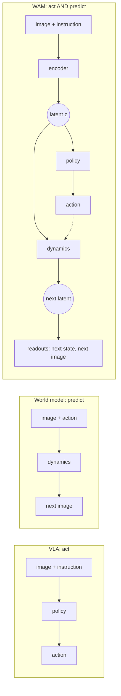

*Figure 1. A VLA acts, a world model predicts, a WAM does both with a shared latent. The dashed arrow is the key: the dynamics can be fed **any** action, the policy's own or one you make up, so you can ask the model "what would happen if…?" and even plan with it.*

A recent survey defines WAMs as models that "connect future-state modeling with executable action generation" ([Lu et al.](https://www.alphaxiv.org/abs/2609.16074)). Another sorts them by the future they produce: pixels, a latent, or nothing at all ([Shen et al.](https://www.alphaxiv.org/abs/2606.20781)).

Here's the map I wish someone had handed me when I moved from VLAs to WAMs. Almost every part of a WAM is something you've met before under a different name:

| If you know… | …in pico-WAM it is | File |
|---|---|---|
| a VLA's vision, language and state encoders | the **observation encoder** that produces the latent $z_t$ | `models/encoders.py`, `models/fusion.py` |
| a VLA's action head: MLP, diffusion, flow | the **policy** $\pi(a_t \mid z_t)$, unchanged | `models/action_heads.py` |
| a simulator or forward model in MPC | the **latent dynamics** $z_{t+1} = f_\theta(z_t, a_t)$ | `models/dynamics_head.py` |
| a state estimator | the **linear state readout** $\hat s = Wz + b$ | `models/dynamics_head.py` |
| an autoencoder's decoder | the **image decoder**, which draws any latent | `models/image_decoder.py` |
| rolling out a model in MPC | **imagination**: apply $f_\theta$ repeatedly | `PicoWAMPolicy.imagine` |
| sampling-based MPC | the **latent planner** | `scripts/plan.py` |
| a linear probe in interpretability | the readout, literally a linear probe trained jointly | `StateReadout` |

---

## Part 2 — The WAM design space, and the WAMs you can download today

Every WAM, from my one-million-parameter model to a 5B-parameter video model, makes the same four decisions:

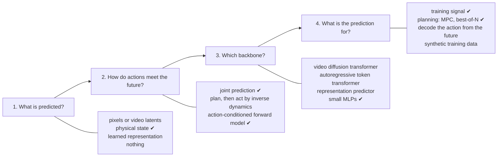

*Figure 2. The four decisions. Ticks mark pico-WAM's choices.*

Let me walk through each decision in plain words.

1. **What is predicted?** You can predict raw future frames (expensive, but you can look at them), a compressed learned representation (cheap, but harder to inspect), the physical state (only possible when you know it, as in simulation), or nothing at all. pico-WAM predicts the physical state, and pixels as an option.
2. **How do actions meet the future?** You can generate the action and the future together ("joint prediction"). You can generate the future first, then ask an *inverse dynamics* model which action gets you there ("plan, then act"). Or you can build an explicit forward model that takes *any* action as input. pico-WAM trains jointly *and* has an explicit action-conditioned forward model, which is what makes "what if" questions and planning possible.
3. **Which backbone?** Big systems reuse pretrained video-generation models. I use small MLPs so everything trains on a laptop.
4. **What is the prediction for?** It can shape the representation during training (the cheapest option and the most common), rank candidate actions at test time (planning), produce the action directly, or generate fake training data for another policy. pico-WAM does the first two: the world model is trained alongside the policy, and Part 6 plans with it.

### A tour of eight open-source WAMs

Here are eight WAMs whose code you can download today. They span the whole design space:

- **GR-1** ([Wu et al.](https://www.alphaxiv.org/abs/2312.13139)) is a GPT-style transformer, pretrained to predict future frames from Ego4D human videos, then fine-tuned to output actions *and* future images. The future prediction is an auxiliary training signal.
- **UWM** ([Zhu et al.](https://doi.org/10.15607/rss.2025.xxi.015)) puts video diffusion and action diffusion into one transformer, with a separate noise level for each. By choosing which one to denoise, the same network acts as a policy, a forward model, an inverse model or a video generator. That trick also lets it learn from videos that have no action labels.
- **WorldVLA** ([Cen et al.](https://www.alphaxiv.org/abs/2506.21539)) turns images, text and actions into discrete tokens in one autoregressive multimodal LLM, which learns both to output action tokens and to predict the next frame.
- **Genie Envisioner** ([Liao et al.](https://www.alphaxiv.org/abs/2508.05635)) is a 2B-parameter video diffusion transformer pretrained on about a million real robot episodes, with a lightweight flow-matching action module that reads its video latents. The video model doubles as a neural simulator.
- **Cosmos Policy** ([Kim et al.](https://www.alphaxiv.org/abs/2601.16163)) fine-tunes NVIDIA's 2B Cosmos-Predict2 video model *without changing its architecture*: actions, robot state and value estimates are written into the video latent as extra "frames". At test time it plans by sampling several action proposals and picking the one whose predicted future looks most valuable.
- **V-JEPA 2-AC** ([Assran et al.](https://www.alphaxiv.org/abs/2506.09985)) never predicts pixels. It trains a 300M-parameter action-conditioned predictor on top of a frozen self-supervised video encoder, and plans with model-predictive control in that representation space. It has no action head at all; the planner picks the actions.
- **DreamGen** ([Jang et al.](https://www.alphaxiv.org/abs/2505.12705)) uses a video world model as a *data generator*. It fine-tunes a video model on a few robot demos, generates many new videos, labels them with an inverse-dynamics or latent-action model, and trains an ordinary policy on the result.
- **LingBot-VA** ([Li et al.](https://www.alphaxiv.org/abs/2601.21998)) is a 5.3B-parameter autoregressive video-action model that predicts future video latents and reads actions off them with inverse dynamics. Its KV cache keeps a long memory of the past.

| System | Predicts | Backbone | How actions come out | Prediction used for |
|---|---|---|---|---|
| GR-1 | future frames | GPT-style transformer, video-pretrained | linear head | training signal |
| UWM | video + actions | one diffusion transformer, separate noise per modality | action diffusion | policy, forward or inverse model, video |
| WorldVLA | next frame as tokens | autoregressive multimodal LLM | discrete action tokens | training signal |
| Genie Envisioner | video chunks | video diffusion transformer, 2B | flow-matching module | action decoding, neural simulator |
| Cosmos Policy | future states + values | video diffusion, 2B | actions as latent frames | best-of-N planning |
| V-JEPA 2-AC | future representations | frozen encoder + 300M predictor | none: the planner acts | MPC planning |
| DreamGen | robot videos | fine-tuned video generator | inverse dynamics labels | synthetic data |
| LingBot-VA | video latents | autoregressive diffusion, 5.3B | inverse dynamics | action decoding, memory |
| **pico-WAM** | **state, pixels, latents** | **CNN + GRU + MLPs, 1.3M** | **MLP, diffusion or flow head** | **training signal, planning** |

Two systems that plan on Push-T itself are worth knowing too. **DINO-WM** ([Zhou et al.](https://www.alphaxiv.org/abs/2411.04983)) plans with the cross-entropy method in the features of a frozen DINOv2 encoder, with a predictor of about 19M parameters trained on 18,500 Push-T trajectories. **PILOT** ([Liu et al.](https://www.alphaxiv.org/abs/2610.14335)) starts that kind of search from a learned policy's actions and beats executing the same policy on long Push-T tasks. Part 6 uses the same idea with a whole model about a fourteenth the size of DINO-WM's predictor alone.

---

## Part 3 — Building pico-WAM, step by step

### 3.1 Push-T, rebuilt for checking

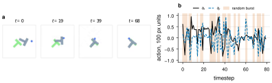

*Figure 3. **Push-T.** (a) Frames of an unseen human demonstration, as the model sees them: the blue agent must push the grey T onto the green target. (b) Actions in one scripted episode, with bursts of random actions shaded.*

Push-T comes from [Diffusion Policy](https://www.alphaxiv.org/abs/2303.04137). A blue disk moves around a 512 × 512 table by following a target point with a spring-like controller, and has to push a T-shaped block until the T covers more than 95% of a green target. It looks simple, but the T only moves where the disk touches it, contacts are frictionless, and lining up the last few pixels is genuinely hard.

I rebuilt it in `envs/pusht_env.py` with the original physics constants, so it runs headless with [pymunk](https://www.pymunk.org/) and OpenCV. Two changes make it a better lab for world models:

1. **Actions are relative.** An action $a_t \in [-1, 1]^2$ moves the disk's target up to 100 px from the disk, instead of placing it somewhere absolute. A random action is then a local nudge, and "what if I pushed left?" is a meaningful question.
2. **The state is complete.** The T's velocity is reset at every 10 Hz control step. With the original physics it only carries over for one 10 ms sub-step anyway, and resetting it means the eight numbers the model sees determine the next state exactly. So `simulate(state, actions)` reproduces `step()` bit for bit, and I can check *any* prediction against the truth.

The state is eight numbers in the unit square: the disk's position and velocity, and the T's position and orientation (as $\cos\theta$ and $\sin\theta$, so it never wraps). As in the original, the disk's velocity is not visible in a single image.

### 3.2 Human demonstrations from LeRobot

The training data are the 206 human demonstrations of [LeRobot's Push-T dataset](https://huggingface.co/datasets/lerobot/pusht): 25,650 frames at 10 Hz, with the image stored as one AV1 video. `scripts/download_pusht.py` turns them into pico-WAM's format, and needs three small tricks, because the dataset records the disk's position and an *absolute* target, but not the T:

```python
# the T's pose, from its 8 corners in lerobot/pusht_keypoints (bar first, then stem)
bar, stem = corners[:, :4].mean(axis=1), corners[:, 4:].mean(axis=1)
d = stem - bar                                   # the stem points along the T's "down"
angle = np.arctan2(-d[:, 0], d[:, 1])
origin = bar - np.stack([-np.sin(angle), np.cos(angle)], axis=1) * 15.0
```

- the T's pose comes from its corners, stored in the matching [keypoint version](https://huggingface.co/datasets/lerobot/pusht_keypoints) of the dataset;
- the disk's velocity comes from replaying the controller from rest, which reproduces every recorded position to within a ten-thousandth of a pixel;
- each absolute target becomes a relative action; only 29 of 25,650 targets are more than 100 px away on an axis and get clipped.

I checked the result against my simulator. From any recorded state, it predicts the T's next recorded position to within 0.53 px in 99% of steps (a moving T travels a median 3.7 px per step), and my renders differ from the dataset's frames by 0.95 out of 255 per pixel on average.

One surprise: **none of the human demonstrations reaches the 95% success threshold.** Their best coverage averages 84.8%. That's why Push-T papers report coverage rather than success, and I do the same: the score of an episode is the best coverage it reaches.

### 3.3 A scripted expert, and random bursts

Human demonstrations contain only actions people chose. To study what a world model learns from *other* actions, I also wrote a scripted expert (`envs/pusht_expert.py`). For each push it tries about a hundred candidates in the simulator, keeps the one that brings the T closest to the target, and walks around the block to make it. It succeeds in 100% of test episodes.

The data collector in `scripts/collect_data.py` mostly runs that expert, but sometimes hands control to random actions for a few steps:

```python
if burst == 0 and rng.random() < args.random_action_prob:
    burst = rng.integers(1, args.random_burst + 1)           # 1-3 steps
expert_step = burst == 0
...
is_expert.append(float(expert_step))
```

Every transition is tagged `is_expert`. The policy only imitates expert steps; the world model learns from everything. Random actions are drawn from the whole action range, so they really shove the T around: with bursts starting at probability 0.1, the expert still finishes only 17% of episodes.

### 3.4 From pixels, words and numbers to one latent

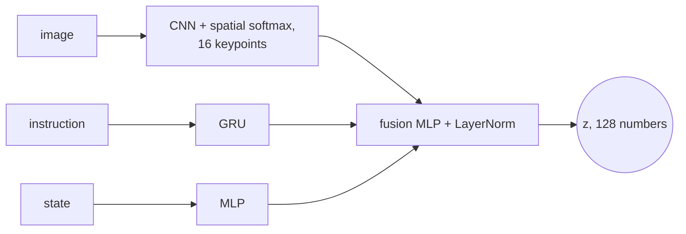

This part is the encoder of [mini-VLA](https://github.com/keivalya/mini-vla), the small VLA I built before pico-WAM, which is also the baseline in every experiment. The one twist is the image encoder. Instead of averaging the CNN's feature maps away, which throws away *where* things are, it ends in a **spatial softmax**: each of 16 feature maps becomes a probability map over the image, and its expected position becomes an $(x, y)$ "keypoint":

```python
def _expected_xy(self, attn):           # attn: (B, K, h, w), sums to 1 over (h, w)
    ys = torch.linspace(-1, 1, h)
    xs = torch.linspace(-1, 1, w)
    kp_x = (attn.sum(dim=2) * xs).sum(dim=-1)
    kp_y = (attn.sum(dim=3) * ys).sum(dim=-1)
    return torch.stack([kp_x, kp_y], dim=-1)    # (B, K, 2)
```

The nice side effect is that you can draw the keypoints on the image and *see* what the encoder looks at (Figure 14).

### 3.5 The policy head

The action head maps $z_t$ to an action. It's the same menu as in any VLA: a plain MLP regressor, a DDPM diffusion head, or a flow-matching head (`models/action_heads.py`). All three expose `loss(actions, z)` and `sample(z)`, so nothing else in the model cares which one you pick. Any of them can also predict a *chunk* of the next $K$ actions at once, as Diffusion Policy does. The default model uses the MLP head with three hidden layers of 512 numbers, and predicts chunks of $K = 8$ actions, executing the first 4 before it asks again:

```python
class MLPActionHead(nn.Module):          # models/action_heads.py
    def __init__(self, action_dim, cond_dim, hidden_dim=512, num_layers=3):
        super().__init__()
        layers, width = [], cond_dim
        for _ in range(num_layers):
            layers += [nn.Linear(width, hidden_dim), nn.ReLU()]
            width = hidden_dim
        self.net = nn.Sequential(*layers, nn.Linear(width, action_dim))   # action_dim = 2 x K
```

This head is the biggest part of the model: 599,568 of its 1,330,923 parameters. Parts 4 and 5 start with a much smaller one, a single hidden layer of 128, and one action per step. Part 6 shows why chunks and the bigger head help.

> **A diffusion detail that is easy to get wrong.** My first diffusion head used a linear noise schedule from $10^{-4}$ to $10^{-2}$ over 16 steps. That sounds reasonable, but it ends at $\bar\alpha_T \approx 0.92$: the "fully noised" action is still 92% signal. Sampling, though, starts from pure Gaussian noise the model never saw in training. Switching to a cosine schedule ($\bar\alpha_T \approx 10^{-5}$) and the proper DDPM posterior fixed it. If you build a diffusion head with few steps, check $\bar\alpha_T$.

### 3.6 The world model: twelve lines

Here is the entire world model, from `models/dynamics_head.py`:

```python
class LatentDynamicsMLP(nn.Module):
    def __init__(self, d_model, action_dim, hidden_dim=256):
        super().__init__()
        self.net = nn.Sequential(
            nn.Linear(d_model + action_dim, hidden_dim), nn.ReLU(),
            nn.Linear(hidden_dim, hidden_dim), nn.ReLU(),
            nn.Linear(hidden_dim, d_model),
        )
        self.ln = nn.LayerNorm(d_model)

    def forward(self, z, action):
        delta = self.net(torch.cat([z, action], dim=-1))
        return self.ln(z + delta)
```

Two small choices make it work:

- **It's residual.** Most of the world stays the same from one step to the next, so the network only has to predict the *change*.
- **It ends in a LayerNorm.** The encoder's latent also ends in a LayerNorm, so imagined latents stay on the same scale as real ones and long rollouts don't drift off to infinity.

### 3.7 Readouts: making the latent readable

A latent is useless to a human unless you can read it. pico-WAM has two readouts, and both work on *any* latent, encoded from a real frame or imagined:

- **A linear state readout**, $\hat s = Wz + b$. I made it linear on purpose. If the disk's and the T's positions can be recovered with a single linear layer, they are explicitly encoded in $z$, and the rows of $W$ tell you which directions mean what.
- **An image decoder** that turns $z$ back into a $64\times64$ picture. It predicts the *difference from the dataset's average image*, with no sigmoid at the end. Most pixels are static background, so the decoder starts out already drawing the background and spends its capacity on what moves.

### 3.8 One training step

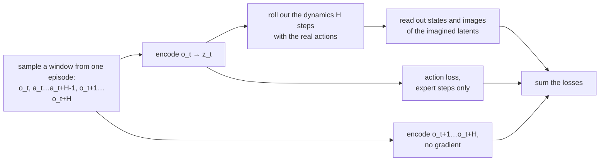

*Figure 4. One training step. The model sees only the first frame; it has to imagine the next H.*

For each training window of $H = 5$ steps:

1. Encode **only the first frame**, $o_t$, into $z_t$.
2. Roll the dynamics forward 5 steps with the actions that were really taken. The model never sees frames $o_{t+1}, \dots, o_{t+5}$.
3. Read out the state and image of every imagined latent and compare them with the truth.
4. Also encode the real future frames, without gradients, and pull the imagined latents toward them. This is **latent consistency**: it keeps imagined latents in the region where the readouts and the policy know what to do. Part 6 shows that the planner depends on it.
5. Add the imitation loss, but only on expert steps:

```python
expert = batch["is_expert"] > 0.5
action_loss = self.policy_head.loss(batch["action"][expert], z[expert])
```

In symbols:

$$\mathcal{L} = \mathcal{L}_{\text{act}} + w_s\,\mathcal{L}_{\text{state}} + w_i\,\mathcal{L}_{\text{image}} + w_z \cdot \tfrac1H \sum_k \|\hat z_{t+k} - \mathrm{sg}[\mathrm{enc}(o_{t+k})]\|^2,$$

with $w_s = 0.5$ and $w_i = w_z = 1$. Delete every term except $\mathcal{L}_{\text{act}}$, along with the dynamics and readouts, and you get **[mini-VLA](https://github.com/keivalya/mini-vla)**, the small VLA that pico-WAM grew out of, with identical encoders and action head. It's the baseline in every experiment, so any difference between the two comes from the world model and its losses.

### 3.9 Imagining and dreaming

Once trained, the model can roll forward in two ways. Both live in one function, `PicoWAMPolicy.imagine`:

```python
z = self.encode_obs(image, text_tokens, state)
for k in range(horizon):
    a = self.policy_head.sample(z)[:, : self.action_dim] if actions is None else actions[:, k]
    z = self.dynamics(z, a)
```

- **Imagined**: you supply the actions. "Given these actions, what happens?" You can check the answer against the real episode.
- **Dreamed**: you pass `actions=None`, and the model's *own policy* chooses each action from its own imagined latent. Nothing from the real world is used after the first frame. "What do I think will happen if I act the way I would act?"

The GIF at the top of the README shows both, side by side with a real episode.

### 3.10 Planning with the world model

Dreaming gives you the policy's plan for free. Planning asks: is there a slightly better plan nearby? `scripts/plan.py` does this at every step, without ever touching the simulator:

```python
prior = model.imagine(image, text_ids, state, H)["actions"][0]      # the policy's own 12-step plan
seqs = (mean + std * noise).clamp(-1, 1)                             # 256 candidates around it
z = model.dynamics.rollout(z0.expand(N, -1), seqs)                   # imagine all of them at once
costs = self.cost(model.denormalize_state(model.state_readout(z)))   # how far is the T from the target?
```

A candidate's cost is the mean distance, in pixels, between the T's corners and the target's corners, read from the imagined states, plus a small pull of the disk toward the T. The planner executes the first action of the cheapest candidate, and at the next step it **starts over from the policy's plan**:

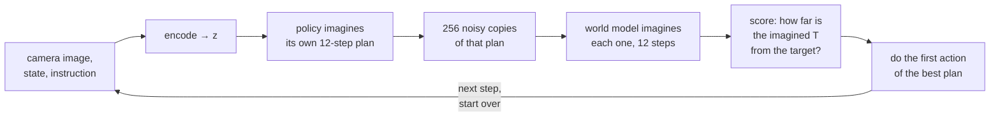

*Figure 5. The planning loop. Nothing in it touches the simulator: every score comes from the world model's imagination.*

Here's one real planning step of the final model:

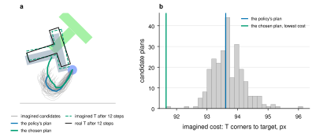

*Figure 6. (a) Grey: the disk paths the world model imagines for the candidate plans. Blue: the policy's own plan. Green: the plan with the lowest imagined cost, which the planner picks. The dashed T is where the model thinks the T will be after the green plan; the black T is where the simulator really puts it. Here they agree well. (b) The imagined cost of all 256 candidates. The policy's plan is good, and the search finds one a bit better.* My first version reused the last step's plan instead, which sounds smarter and isn't; Part 6 shows why. I fixed the settings (one round of 256 candidates, noise 0.1, 12 steps) on 20 development starts that are never used for testing.

### 3.11 Run it yourself

```sh
pip install -r requirements.txt

# download and convert LeRobot's 206 human demonstrations (under a minute)
python -m scripts.download_pusht --output-path data/pusht.npz

# branch the demos in the simulator: "what if the human had pushed differently?" (Part 6)
python -m scripts.branch_demos data/pusht.npz --output-path data/pusht_branched.npz

# train the WAM on demos + branches, and the mini-VLA baseline on the demos alone
# (a GPU helps: --device auto picks CUDA or MPS; drop --predict_image to train about 5x faster)
python -m scripts.train --dataset-path data/pusht_branched.npz --model_type wam --predict_state --predict_image \
  --action-chunk 8 --policy-hidden 512 --policy-layers 3 --epochs 100 --save-path checkpoints/wam.pt --device auto
python -m scripts.train --dataset-path data/pusht.npz --model_type vla --action-chunk 8 --policy-hidden 512 --policy-layers 3 --epochs 100 \
  --save-path checkpoints/vla.pt --device auto

# how good is the imagination? what does the model believe?
python -m scripts.evaluate --checkpoint checkpoints/wam.pt
python -m scripts.visualize_rollout --checkpoint checkpoints/wam.pt --video --gif

# closed loop: the policy alone, then planning with the world model
python -m scripts.test --checkpoint checkpoints/wam.pt --episodes 20
python -m scripts.test --checkpoint checkpoints/wam.pt --episodes 20 --planner mpc
```

For three independent runs of all of it, on one GPU: `bash scripts/run.sh`. Its configuration block at the top is where every experiment in this tutorial changes a setting or two.

---

## Part 4 — Does it actually imagine?

Every number from here on is measured on unseen episodes and averaged over three independent training runs, each with its own train/test split and initialization. Figures show the spread across runs.

A note on the numbers: **state error** is the squared prediction error after dividing each number by how much it usually varies, so 0 is perfect and 1 is about as bad as always guessing the average. **Coverage** is how much of the green target the T covers, and an episode succeeds above 95%.

Parts 4 and 5 study the simplest version first, which I call the **study base**: one action per step, 15 epochs, human demonstrations only. It's the easiest model to understand, and its failures are the most instructive. Part 6 then adds the three changes that make it succeed.

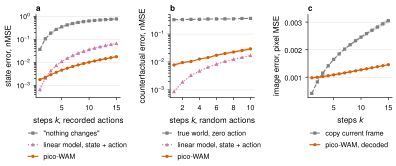

*Figure 7. **Imagined states beat "nothing changes" by far; a straight line does surprisingly well; imagined pixels are mixed.** (a) State error vs. how many steps the model imagines, with the recorded human actions, compared with "nothing changes" and with a linear model of state and action. (b) The same under random actions, checked against the simulator. (c) Pixel error of the decoded imagination vs. just copying the current frame.*

- **States: yes.** After 15 imagined steps, the state error is 0.0178, 44× lower than "nothing changes" (0.7772).
- **But check against a straight line.** A linear model of state and action, fitted by least squares, is *more* accurate one step ahead (0.0007 vs. 0.0018), because the disk follows a linear controller. It falls behind over longer horizons (0.0665 at 15 steps), where the T's contact motion takes over.
- **Pixels: mixed.** One step ahead, the decoded frame is worse than copying the current one; by 15 steps it's better, because by then the real scene has moved.

**What if?** The question I most wanted to ask is "what if I had done something else?" Under random actions the error after 10 steps is 0.0295, far below the 0.364 of a model that ignores the actions. But that average hides something. Split it by object:

- the **disk** is easy: it follows the action;
- the **T** is hard. Under random actions, pico-WAM's 10-step error on the T is 0.0344, *worse* than the 0.0253 you get by simply assuming the T stays where it is. The linear model is no better (0.0326).

In other words, the world model learned how the T moves *when people push it*, not how it responds to pushes people never made. Hold that thought; it explains Part 6.

Here's one episode, as the model sees it:

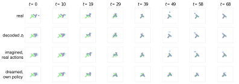

*Figure 8. Real frames; the decoding of each real frame's latent; an imagination from $t = 0$ with the real actions; and a dream, where its own policy acts. The bottom two rows see nothing after the first frame.*

The imagined row keeps the T moving onto the target for 68 steps, from one frame and the human's actions. The dream pushes differently, because the policy acts differently from the person.

And here's what the model believes over time, variable by variable:

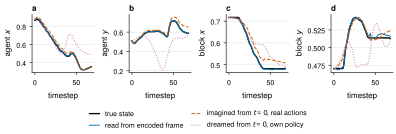

*Figure 9. The disk's and the T's positions over one unseen episode: the truth (black), the readout of each real frame's latent (blue), an imagination from $t = 0$ with the real actions (red dashed), and a dream with the model's own policy (purple dotted).*

**Sustained pushes.** I also pushed it harder: from one start, imagine 15 steps of a constant push in each of eight directions.

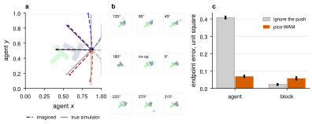

*Figure 10. (a) Imagined (dashed) vs. true (solid) disk trajectories for 15 steps of constant pushing. (b) The decoded imagined frames at the end. (c) Endpoint error averaged over all eight directions and all unseen episodes, compared with a prediction that ignores the push.*

The disk's path is roughly right. The T's is not: averaged over directions, the imagined T ends up further from the truth than if the push had been ignored. Same lesson as above.

Finally, what does the latent space look like inside?

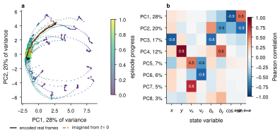

*Figure 11. (a) Unseen latents projected onto their first two principal components, coloured by episode progress. (b) How each principal component correlates with each state variable.*

---

## Part 5 — What worked and what did not

This is the part I'd want to read first if I were building my own WAM. Every row below is a real experiment with three runs; "coverage" is the best coverage of the target in an episode, averaged over 100 unseen starts.

Rows marked *base* change one thing of the study base; rows marked *chunks* change one thing of the model with action chunks (Part 6).

| What I changed | What happened | What I learned |
|---|---|---|
| *base:* human demos → scripted expert, with or without random bursts | the T's error under new pushes went from 1.36× "the T stays put" to about half of it, but every policy got worse | the data decides what "what if" means |
| *base:* training horizon $H$ = 1, 5, 10 | planning coverage 27.8%, 37.0%, 33.9% | train on roughly the horizon you plan over |
| *base:* no latent consistency | planning 23.7%, against 37.0% | latent consistency is for planning |
| *base:* no image loss | planning 38.1%, the same | images are for you, not for the planner |
| *chunks:* no image decoder | planning 38.0%, against 39.2%, at a tenth of the training cost | same lesson, and a free 10× speedup |
| *base:* pixels only, no state input | about 10% for every policy | the state input carries most of the information |
| *chunks:* latent width 64; *base:* 256 | planning 36.3% and 35.2%, neither better than 128 | 128 numbers are enough for the latent |
| *final:* action head 1×128 → 3×512 | planning successes 77 → 121, the WAM's own policy 7 → 85 | the action head was the bottleneck |
| *final:* pixels only | WAM planning 46 successes, mini-VLA 0 | without the state, the world model's training is what makes it work |
| *base:* diffusion head | mini-VLA 14.2%, against 24.2% | a fancier head needs more training |
| *chunks:* $K$ = 16, averaging chunks, plain CNN | mini-VLA 32.5%, 39.0%, 44.7%, against 40.2% | the simple choices are fine |
| *base:* search harder | planning fell from 33.8% to 18.2% | search finds the model's mistakes |
| *base:* predict 8 actions, execute 4 | mini-VLA 24.2% → 40.2%, and the first successes | commit to a few actions at a time |
| *chunks:* 100 epochs | mini-VLA 68.0% with 62 successes in 300, but planning fell to 20.2% | train longer, and watch your planner |
| *chunks:* branch the demos in the simulator | the T's error fell from 1.31× to 0.45× "the T stays put" | show the model the pushes people didn't make |
| pixel pilot: + current state, + future state | coverage 6.3% → 14.2% → 11.7% | supervising the present does the work |

### Lesson 1: the data decides what "what if" means

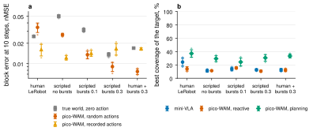

*Figure 12. (a) Error on the T after 10 imagined steps, under random actions (red) and recorded actions (orange), compared with assuming the T stays put (grey), for each training dataset. (b) Coverage of mini-VLA, the reactive WAM and the planning WAM trained on each dataset.*

Part 4 showed that the world model trained on human demonstrations predicts the T *worse* than assuming it stays put when you push in ways people didn't. Is that the model's fault, or the data's? To find out, I trained the same model on four other datasets made with the scripted expert of Part 3.3.

Each dataset has its own test episodes, so to compare them fairly I divide the model's error on the T by the error of "the T stays put" on the same starts. Below 1 means the model knows something real about how the T responds to a push.

| Training data | T error ÷ "stays put" | mini-VLA coverage | Planning coverage |
|---|---|---|---|
| human demos | 1.36 | 24.2% | 37.0% |
| scripted, no bursts | 0.53 | 11.3% | 29.3% |
| scripted, bursts 0.1 | 0.43 | 13.8% | 24.3% |
| scripted, bursts 0.3 | 0.66 | 12.6% | 30.6% |
| human + scripted, bursts 0.3 | 0.45 | 12.4% | 33.3% |

Two things happen at once:

- **The scripted data teaches the T's response.** The expert tries pushes from all around the T, and random bursts add even more variety, so every scripted dataset brings the ratio well below 1.
- **But every policy gets worse.** The policy learns to copy the scripted expert much less well than it copies people. I didn't test why; my guess is that the expert's choices come from a search the policy can't see, so from the policy's point of view they look arbitrary.

So a planner needs two things: a world model that knows what pushes do, and a policy whose plans are worth searching around. Part 6 gets both, by keeping the human demos and branching them in the simulator.

### Lesson 2: you get good at the horizon you train on, and latent consistency is for planning

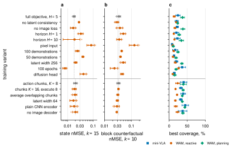

*Figure 13. Top group: each row changes one thing of the study base, grey. Bottom group: each row changes one thing of the model with action chunks, grey. (a) State error after 15 imagined steps. (b) Error on the T after 10 random-action steps. (c) Coverage of mini-VLA, the reactive WAM and the planning WAM.*

Each row of Figure 13 changes one thing; the grey row at the top of each group is its reference.

- **Horizon.** Training on one-step windows makes the model worse at 15 steps (0.0329 against 0.0178) and planning drops to 27.8%. Ten-step windows give 33.9%. Five steps is a good middle: the planner looks 12 steps ahead, and the model has to stay sensible that far.
- **Latent consistency.** Without it, the error under random actions barely changes, but planning falls to 23.7%. The planner feeds imagined latents to the readout, 12 steps deep. Latent consistency keeps those imagined latents looking like the encodings of real frames, which is the only kind of latent the readout and the policy were trained on.
- **Images.** Without the image loss, planning reaches 38.1%, about the same. In the chunked model, removing the image decoder entirely gives 38.0% against 39.2%. The decoder is for *you*, so you can watch the imagination; the planner only reads states. It also costs about 10× in training time, which is why `scripts/run.sh` has a `PREDICT_IMAGE` switch: 1 to watch, 0 to go fast.
- **Pixels only.** Without the state input, every policy drops to about 10% and the 15-step state error rises to 0.0838. A single frame doesn't show velocity, and 206 demonstrations are not much to learn vision from.
- **Width of the latent.** Halving the latent to 64 numbers lowers planning to 36.3%. Doubling it to 256 doesn't help at 15 epochs (35.2%) and makes the T's counterfactual error worse. 128 numbers are enough for this task. What *was* too small is the action head, which Part 6 fixes.
- **Fewer demos** make everything worse, as you'd expect: 24.5% planning with 100 demos, 19.0% with 50.
- **A diffusion head** is worse at 15 epochs (mini-VLA 14.2%). A more expressive head needs more training; the MLP is the simple default.
- **The chunked model's variants**, in the bottom group: 16-action chunks, averaging overlapping chunks, and a plain CNN instead of keypoints. None is clearly better than the default. When the simple choice works as well, keep the simple choice.

### Lesson 3: an encoder learns to look only when it has to

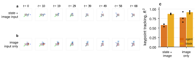

*Figure 14. Spatial-softmax keypoints on an unseen episode. (a) A model that also gets the state. (b) A model that gets only the image. (c) How well the best keypoint tracks the disk and the T.*

With the state as input, the keypoints barely move: the best one tracks the disk with $R^2$ = 0.58 and the T with 0.87. Take the state away, and the same encoder learns keypoints that follow the scene: 0.78 for the disk and 0.92 for the T. The network only learns to look when looking is the only way to know where things are. If you ever see a vision encoder that seems to ignore the image, check what else it's being given.

### Lesson 4: supervising the present does most of the work for a pixel policy

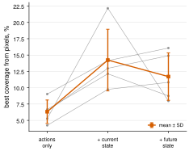

*Figure 15. A matched pilot from pixels only: behavioral cloning, plus current-state supervision, plus future-state prediction. Each grey line is one run.*

Part 5's pixel-only row is a WAM that gets no state input, but still learns from true-state *targets*. Is it the prediction of the future that helps such a policy, or simply being told where things are now? To separate the two, I trained three models from pixels only, with matched windows, initializations, batches and number of updates, on five runs:

1. **behavioral cloning alone:** 6.3% coverage;
2. **+ current-state supervision**, the readout of the current latent: 14.2%;
3. **+ future-state prediction** on top: 11.7%.

Supervising the current state adds 7.9 points; predicting the future adds −2.5. In the paper's point-mass world the same pilot gives future prediction a small extra gain. Either way, most of the help comes from telling the network where things are, not from predicting where they will be. If you add auxiliary prediction to a policy, run this control; it's cheap.

---

## Part 6 — From prediction to control

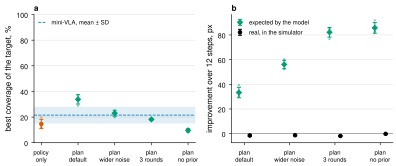

*Figure 16. (a) Coverage of the policy alone and of four planners that use the same world model: the default, wider noise, three rounds of search, and three rounds with no policy to start from. The blue band is mini-VLA. (b) For each planner, how much closer to the target the model expected its chosen 12-step plan to bring the T, and how much closer it really came in the simulator.*

### 6.1 Planning beats the policy, if the search stays close

At the study base, the WAM acting on its own covers 14.0% of the target at best, below mini-VLA's 24.2%. My guess at the time: the prediction losses compete with the policy for the shared latent. Step 4 of 6.2 shows that guess was mostly wrong. Planning with the same world model reaches 37.0%, better than mini-VLA in every run. Nothing new was trained: the same network is used differently.

So why not search harder? Figure 16 tries it on the same trained models: wider noise, three rounds of the cross-entropy method, and three rounds starting from standing still instead of from the policy. Coverage falls every time, down to 9.6% without the policy.

Panel (b) shows why. Every 10 steps I take the plan the planner chose and run it in the real simulator from the same state. The model *believes* its plans get better as it searches harder: the expected improvement grows from 33.3 px to 82.1 px. In the simulator, the same plans improve nothing (between −1.9 and −0.1 px). A planner is an optimizer, and an optimizer pointed at an imperfect model finds the model's errors. Searching near the policy's plan keeps it in the region where the model has seen data.

### 6.2 Four changes that make it succeed

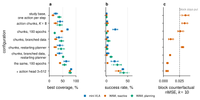

*Figure 17. Each row adds one change. (a) Best coverage of the target. (b) Success rate: episodes where the T covers more than 95% of the target. (c) Error on the T after 10 random-action steps; the dashed line is "the T stays put". The first four rows plan with my first planner, the others with the restarting planner.*

**1. Predict a few actions at a time.** With action chunks, the policy predicts the next 8 actions and executes 4 before asking again, as Diffusion Policy does:

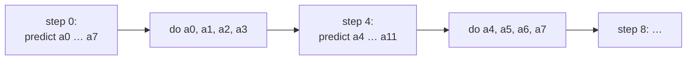

*Figure 18. Action chunks: predict 8 actions, do the first 4, then predict again from the new observation.*

Mini-VLA goes from 24.2% to 40.2%, the reactive WAM from 14.0% to 23.5%, and the first episodes succeed. My intuition: human demonstrations pause and hesitate, and a policy that decides one step at a time can dither between two ways of pushing; committing to a short sequence keeps it moving.

**2. Train longer, and restart every search.** Training for 100 epochs instead of 15 makes the policies much better: mini-VLA covers 68.0% and succeeds in 62 of 300 episodes. The world model gets better too, with a 15-step error of 0.0112 instead of 0.0202. Yet planning fell from 39.2% to 20.2%. A better model made a worse planner.

The bug was in my planner, not in the model. My first version reused its last plan: it started each search from the previous step's plan and kept that plan unless something scored better.

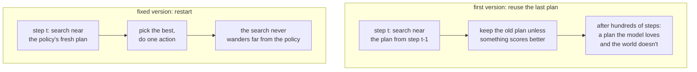

*Figure 19. Why reusing the last plan goes wrong.*

Over a 300-step episode, reusing the plan piles up hundreds of rounds of search on the same imagined future. It's the "search harder" experiment of 6.1 again, by accident. On development episodes, the plans it chose expected to bring the T 74 px closer to the target, while the simulator moved it 7 px further away. The fix is one line: start every search from the policy's own plan (`warm_start=False`, the default now).

**3. Show the world model the pushes people didn't make.** Lesson 1 showed that the model needs to see other pushes, but scripted data hurt the policy. So I keep the human demos and *branch* them in the simulator (`scripts/branch_demos.py`):

```python
# from every 4th human state: replay the next 8 human actions, pushed a bit differently
actions = np.clip(data["actions"][i : i + L] + args.noise * rng.standard_normal((L, 2)), -1.0, 1.0)
```

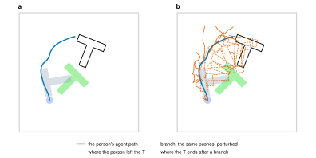

*Figure 20. (a) A stretch of one human demonstration: the path of the disk, and where the person left the T. (b) The same stretch with its branches. Each branch replays the person's next 8 pushes with some noise added, and the simulator says where the disk and the T really end up.*

The simulator says what really happens, and the env draws every new frame. The 206 demos become 6,013 extra branches, 48,104 transitions, and the T moves in a third of them. Branches are marked `is_expert = 0`, so only the world model learns from them; mini-VLA never sees them, because copying noisy pushes would only teach it the noise. The simulator is used once, to make data, and never while planning.

With branches, the T's error under new pushes drops from 1.31× to 0.45× "the T stays put" (Figure 17c). For the first time, the model knows better than "nothing moves" what a new push does to the T.

**Together, at 15 and then 100 epochs.** With chunks, branches and the restarting planner, still at 15 epochs, planning covers 51.5% and succeeds in 32 of 300 episodes, against 37.6% and 8 successes for mini-VLA trained in the same runs. Trained for 100 epochs, planning succeeds in 77, and the old reuse-the-last-plan planner, on the same models, in only 11. But the WAM's own policy is stuck: 7 successes, 23.2 points of coverage behind mini-VLA.

**4. Give the policy a bigger head.** Until here, both models turned the latent into actions with one hidden layer of 128 numbers. That's small for a head that has to output 16 numbers, 8 two-dimensional actions, from the human demonstrations' messy pushes. I tried a few sizes:

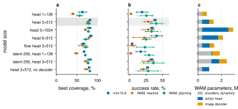

*Figure 21. Action-head and latent sizes, all trained like the row above with 100 epochs. The shaded row is the final model. (a) Best coverage. (b) Success rate. (c) Parameters of the WAM, split into encoders and dynamics, action head and image decoder.*

- **Three hidden layers of 512 helps everything.** Mini-VLA goes to 116 successes, the WAM's own policy from 7 to 85, and planning from 77 to 121.
- **Bigger doesn't help further.** Three layers of 1024 or six layers of 512 add parameters without improving planning, and a flow-matching head of the same size does worse.
- **The latent was fine.** A latent of 256 helps the small head, but adds nothing once the head is 3×512.

This also corrects something I believed earlier. I thought the WAM's own policy was weak because the prediction losses compete with it for the shared latent. With the bigger head the gap to mini-VLA shrinks from 23.2 to 4.4 points of coverage: it was mostly the small head. The price is size: the head has 599,568 parameters, so the WAM grows to 1.33 million, or 0.96 million without the image decoder.

**The final model.** This is the default in `scripts/run.sh`, and the one in the GIF at the top of the README. Planning succeeds in 121 of 300 unseen episodes, with a best coverage of 78.4%. Mini-VLA succeeds in 116, with 81.6%. They're now close; mini-VLA wins two of the three runs on successes, planning wins the third by a lot. The WAM's own policy, without planning, succeeds in 85. And the world model is the best in the study: its error on the T under random pushes is 0.22× "the T stays put". Here's one of its successful episodes:

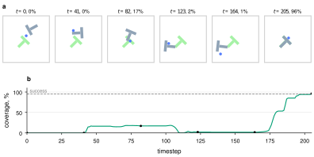

*Figure 22. The final model planning on an unseen start. (a) Six moments of the episode, with how much of the target the T covers. (b) Coverage over time; the episode succeeds when it passes 95%. Notice the long middle stretch: the T partly covers the target, slips off, and the planner has to walk around and push again.*

One caution: these numbers move between runs. In the "chunks, 100 epochs" experiment, exactly the same mini-VLA configuration reached 68.0% and 62 successes, against 63.5% and 57 in the next run. Three runs are enough to see big effects, not small ones. And I chose the head size by looking at these same test episodes, so treat 3×512 as a good choice, not a measured optimum.

### 6.3 Where the world model really pays off: pixels only

With the state as input, mini-VLA is a strong baseline: the state tells it exactly where the T is. Take the state away, so both models see only the camera image and the instruction, and the picture changes completely:

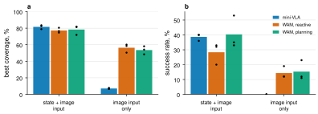

*Figure 23. The final configuration with state and image input, and the same configuration with image input only. (a) Best coverage. (b) Success rate. Each dot is one run.*

From pixels, mini-VLA covers 7.1% of the target and never succeeds. The WAM's own policy covers 56.4% and succeeds in 43 episodes, and planning in 46. A single frame doesn't show which way the disk is moving, and mini-VLA has only the action labels to learn from. The WAM also has to predict states, images and its own future latents, which forces its encoder to work out where things are. That's the Lesson 4 pilot again, at full scale. To be fair, the WAM here also learns from the branches, which mini-VLA can't use, so this compares the whole WAM recipe, not one loss.

---

## Part 7 — Where the cost goes

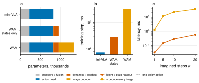

*Figure 24. The final model. (a) Parameters per module. (b) Time for one training step, batch 64. (c) Time to imagine k steps, with and without decoding images, compared with one policy action. Measured on one CPU thread of a laptop.*

- **Most parameters sit in the action head.** Of the WAM's 1,330,923 parameters, 599,568 are the 3×512 action head and 375,811 the image decoder; the encoders, the dynamics and the readouts together are the small rest.
- **Acting is cheap.** One policy action takes 0.47 ms, for the WAM and mini-VLA alike, because the reactive policy never calls the world model.
- **Planning is cheap too.** One planning step imagines 256 candidate futures of 12 steps and takes 36 ms, well inside Push-T's 100 ms control period. For comparison, DINO-WM reports 53 s for one plan with the cross-entropy method on a datacenter GPU, with a different planning setup.
- **Training is where pixels cost you.** One WAM training step costs 3.18 s against 73 ms for mini-VLA. Remove the image decoder and it drops to 0.29 s. On the cluster, a full run of the final model takes 4 h 11 min with the decoder and 1 h 03 min without it.
- **The whole study is small.** Every run trains three seeds side by side on one cluster GPU. All 37 Push-T runs together took about 90 GPU-hours.

If you want your WAM to be fast:

1. **Predict states or compact latents before pixels.** That's where the cost is.
2. **Keep small datasets on the GPU** and build batches by indexing, not with a per-sample loader.
3. **Roll out in latent space**, and decode only when you actually want to look.

---

## Part 8 — Honest limitations

- **Success is still the exception.** The final planning WAM succeeds in about two of every five episodes, 121 of 300, and mini-VLA is about as good when it can see the state. pico-WAM is built for learning how WAMs behave, not for topping a benchmark.
- **The branches need a simulator.** On a real robot you can't replay a state and push differently; you'd need play data or deliberately perturbed demonstrations instead.
- **Privileged state.** With the state as input, the policy sees the T's exact pose. The pixel-only experiments remove that input, but the WAM still learns from true-state targets.
- **The planner's cost is hand-written.** It knows the target pose and measures distances in pixels; a learned value function would be more general.
- **Three runs per configuration** (five in the pilot) are enough to see big effects, not small ones, and many of the comparisons use 15-epoch models.
- **The head size was picked on the test episodes.** I compared a handful of sizes on the same unseen starts I report, so 3×512 is a good choice, not a measured optimum.

---

## Part 9 — Try it yourself

Some exercises, in rough order of difficulty. Everything you need is already in the code.

1. **Break it on purpose.** Run `BRANCHES=0 bash scripts/run.sh`, so the world model sees only the human demos, and look at `4_what_if.png` from `visualize_rollout.py`. Does the imagined T still react to pushes? What happens to planning?
2. **Search harder.** Try `--planner-config '{"iterations": 3, "noise": 0.3}'` in `scripts/test.py`. Does coverage go up or down, and why?
3. **Give the policy memory.** Stack the last two frames as input and rerun the pixel-only comparison. How much of the WAM's advantage survives?
4. **Learn the cost.** Replace the planner's hand-written distance with a learned value of the imagined latent.
5. **Go real.** `collect_data.py` and `test.py` already support Meta-World (`--env metaworld`). What breaks first?

---

## Glossary

- **Action chunk:** a short sequence of future actions the policy predicts at once; pico-WAM predicts 8 and does the first 4.
- **Action head:** the last part of the policy, a small network that turns the latent into actions.
- **Behavioral cloning (BC):** training a policy to copy expert actions, as supervised learning.
- **Branching:** replaying a demonstration from one of its states with slightly different actions, and letting the simulator say what happens.
- **Counterfactual prediction:** predicting what *would* happen under actions that were not taken.
- **Coverage:** the fraction of Push-T's target covered by the T; an episode's score is the best coverage it reaches.
- **Cross-entropy method:** a simple search: sample many candidate plans, keep the best few, sample new candidates around those, and repeat.
- **Factual prediction:** predicting what *did* happen, given the recorded actions.
- **Imagination, rollout:** applying the dynamics model repeatedly without new observations.
- **Inverse dynamics:** inferring the action that moved the world from one state to the next.
- **Latent ($z$):** the network's internal summary vector.
- **Linear probe, readout:** a single linear layer that reads a property, like a position, out of a latent.
- **mini-VLA:** the small VLA from [an earlier project](https://github.com/keivalya/mini-vla) whose encoders pico-WAM extends; pico-WAM without its world model, and the baseline in every experiment.
- **MPC, model-predictive control:** planning by imagining candidate action sequences with a model and executing the first action of the best one.
- **Spatial softmax:** turning a feature map into the expected $(x, y)$ position of its activation.
- **VLA:** vision-language-action model, a policy that maps images and instructions to actions.
- **Warm start:** starting each planning search from the previous step's plan; pico-WAM's planner restarts from the policy's plan instead.
- **WAM:** world action model, a policy that also predicts how its actions change the world.

## FAQ

**Do I need a GPU?** It helps. On an Apple-silicon laptop, `--device auto` uses its GPU and 15 epochs take about 20 minutes; the default 100 epochs on demos plus branches take several hours, or about five times less with `--predict_image` left out. On CPU alone, expect much longer. The study ran on single cluster GPUs.

**Why not just use a big pretrained WAM?** You should, for real robots. But at billions of parameters it's hard to see *why* things work. pico-WAM is for building intuition that you can carry back to the big models.

**Is the world model ever used when the robot acts?** Yes, when you plan with it: `scripts/test.py --planner mpc`. The plain policy never calls it.

**What's the difference between "imagined" and "dreamed"?** Imagined uses actions you provide, usually the real ones; dreamed lets the model's own policy pick actions inside its imagination.

---

## Reproducing everything

```sh
bash scripts/run.sh   # 3 runs of the final model: data, branches, train WAM + mini-VLA, evaluate, test, plan, visualize, summarize
```

The defaults at the top of `scripts/run.sh` are the final model of Part 6, and every other experiment is the same command with a few settings changed. Results land in `results/pusht/`; the planner that reuses its last plan is always tested too, in `wam_mpc_warm_test.json`.

| Results folder | What it is | Command |
|---|---|---|
| `final` | the final model: the defaults | `bash scripts/run.sh` |
| `baseline` | the study base | `ACTION_CHUNK=1 EPOCHS=15 BRANCHES=0 POLICY_HIDDEN=128 POLICY_LAYERS=1 bash scripts/run.sh` |
| `horizon-1`, `horizon-10` | imagination window $H$ = 1 or 10 | `ACTION_CHUNK=1 EPOCHS=15 BRANCHES=0 POLICY_HIDDEN=128 POLICY_LAYERS=1 HORIZON=1 bash scripts/run.sh` |
| `no-latent` | no latent consistency | `ACTION_CHUNK=1 EPOCHS=15 BRANCHES=0 POLICY_HIDDEN=128 POLICY_LAYERS=1 LATENT_WEIGHT=0 bash scripts/run.sh` |
| `no-image` | no image loss | `ACTION_CHUNK=1 EPOCHS=15 BRANCHES=0 POLICY_HIDDEN=128 POLICY_LAYERS=1 IMAGE_WEIGHT=0 bash scripts/run.sh` |
| `pixel-input` | no state input | `ACTION_CHUNK=1 EPOCHS=15 BRANCHES=0 POLICY_HIDDEN=128 POLICY_LAYERS=1 STATE_INPUT=0 bash scripts/run.sh` |
| `demos-100`, `demos-50` | fewer human demos | `ACTION_CHUNK=1 EPOCHS=15 BRANCHES=0 POLICY_HIDDEN=128 POLICY_LAYERS=1 DEMOS=100 bash scripts/run.sh` |
| `expert-p0` | scripted expert, no random bursts | `ACTION_CHUNK=1 EPOCHS=15 BRANCHES=0 POLICY_HIDDEN=128 POLICY_LAYERS=1 PUSHT_DATA=expert RANDOM_ACTION_PROB=0 bash scripts/run.sh` |
| `expert-p0.1`, `expert-p0.3` | scripted expert with random bursts | `ACTION_CHUNK=1 EPOCHS=15 BRANCHES=0 POLICY_HIDDEN=128 POLICY_LAYERS=1 PUSHT_DATA=expert RANDOM_ACTION_PROB=0.1 bash scripts/run.sh` |
| `mixed-p0.3` | human demos plus scripted bursts | `ACTION_CHUNK=1 EPOCHS=15 BRANCHES=0 POLICY_HIDDEN=128 POLICY_LAYERS=1 PUSHT_DATA=mixed RANDOM_ACTION_PROB=0.3 bash scripts/run.sh` |
| `diffusion-head` | diffusion action head | `ACTION_CHUNK=1 EPOCHS=15 BRANCHES=0 POLICY_HIDDEN=128 POLICY_LAYERS=1 ACTION_HEAD=diffusion bash scripts/run.sh` |
| `wider-model` | latent of 256 | `ACTION_CHUNK=1 EPOCHS=15 BRANCHES=0 POLICY_HIDDEN=128 POLICY_LAYERS=1 D_MODEL=256 bash scripts/run.sh` |
| `epochs-100` | 100 epochs | `ACTION_CHUNK=1 EPOCHS=15 BRANCHES=0 POLICY_HIDDEN=128 POLICY_LAYERS=1 EPOCHS=100 bash scripts/run.sh` |
| `planner-budget` | three bigger search budgets | `ACTION_CHUNK=1 EPOCHS=15 BRANCHES=0 POLICY_HIDDEN=128 POLICY_LAYERS=1 PLAN_SWEEP=1 bash scripts/run.sh` |
| `supervision-pilot` | the matched pilot, five runs | `ACTION_CHUNK=1 EPOCHS=15 BRANCHES=0 POLICY_HIDDEN=128 POLICY_LAYERS=1 MODE=supervision SEEDS='0 1 2 3 4' bash scripts/run.sh` |
| `action-chunks`, `chunks-restart-planner` | predict 8 actions, execute 4 | `EPOCHS=15 BRANCHES=0 POLICY_HIDDEN=128 POLICY_LAYERS=1 bash scripts/run.sh` |
| `chunks-k16` | predict 16, execute 8 | `EPOCHS=15 BRANCHES=0 POLICY_HIDDEN=128 POLICY_LAYERS=1 ACTION_CHUNK=16 bash scripts/run.sh` |
| `chunks-temporal-ensembling` | average overlapping chunks | `EPOCHS=15 BRANCHES=0 POLICY_HIDDEN=128 POLICY_LAYERS=1 TEMPORAL_ENSEMBLE=1 bash scripts/run.sh` |
| `chunks-dmodel-64` | latent of 64 | `EPOCHS=15 BRANCHES=0 POLICY_HIDDEN=128 POLICY_LAYERS=1 D_MODEL=64 bash scripts/run.sh` |
| `chunks-plain-cnn` | plain CNN image encoder | `EPOCHS=15 BRANCHES=0 POLICY_HIDDEN=128 POLICY_LAYERS=1 IMAGE_ENCODER=cnn bash scripts/run.sh` |
| `chunks-no-decoder` | no image decoder | `EPOCHS=15 BRANCHES=0 POLICY_HIDDEN=128 POLICY_LAYERS=1 PREDICT_IMAGE=0 bash scripts/run.sh` |
| `chunks-epochs-100` | 100 epochs | `BRANCHES=0 POLICY_HIDDEN=128 POLICY_LAYERS=1 bash scripts/run.sh` |
| `chunks-branched`, `branched-restart-planner` | simulator branches | `EPOCHS=15 POLICY_HIDDEN=128 POLICY_LAYERS=1 bash scripts/run.sh` |
| `branched-restart-100-epochs` | the same, 100 epochs | `POLICY_HIDDEN=128 POLICY_LAYERS=1 bash scripts/run.sh` |
| `head-3x1024` | action head 3×1024 | `POLICY_HIDDEN=1024 bash scripts/run.sh` |
| `head-6x512` | action head 6×512 | `POLICY_LAYERS=6 bash scripts/run.sh` |
| `flow-head-3x512` | flow-matching head | `ACTION_HEAD=flow bash scripts/run.sh` |
| `latent-256` | latent 256, head 1×128 | `D_MODEL=256 POLICY_HIDDEN=128 POLICY_LAYERS=1 bash scripts/run.sh` |
| `head-3x512-latent-256` | latent 256, head 3×512 | `D_MODEL=256 bash scripts/run.sh` |
| `head-3x512-no-decoder` | no image decoder | `PREDICT_IMAGE=0 bash scripts/run.sh` |
| `pixel-input-head-3x512` | no state input | `STATE_INPUT=0 bash scripts/run.sh` |

For a pair of folders, the command shows the first one; change the one number for the second. Each experiment was originally run from its own git branch, and the branches are all merged into `main` now. `docs/results/pusht/README.md` lists the exact branch, commit and run of every folder, if you want the code exactly as it ran. The results of every run are in `docs/results/pusht/`. `python docs/figures/pusht_figures.py` rebuilds every figure in this tutorial from them, and `python docs/figures/pusht_numbers.py` prints every number.

## References

1. Assran, M. et al. *V-JEPA 2: Self-Supervised Video Models Enable Understanding, Prediction and Planning.* 2025. [alphaXiv](https://www.alphaxiv.org/abs/2506.09985)
2. Cen, J. et al. *WorldVLA: Towards Autoregressive Action World Model.* 2025. [alphaXiv](https://www.alphaxiv.org/abs/2506.21539)
3. Chi, C. et al. *Diffusion Policy: Visuomotor Policy Learning via Action Diffusion.* 2023. [alphaXiv](https://www.alphaxiv.org/abs/2303.04137)
4. de Haan, P., Jayaraman, D. & Levine, S. *Causal Confusion in Imitation Learning.* 2019. [doi](https://doi.org/10.48550/arxiv.1905.11979)
5. Jang, J. et al. *DreamGen: Unlocking Generalization in Robot Learning through Video World Models.* 2025. [alphaXiv](https://www.alphaxiv.org/abs/2505.12705)
6. Kim, M. J. et al. *Cosmos Policy: Fine-Tuning Video Models for Visuomotor Control and Planning.* 2026. [alphaXiv](https://www.alphaxiv.org/abs/2601.16163)
7. Li, L. et al. *Causal World Modeling for Robot Control* (LingBot-VA). 2026. [alphaXiv](https://www.alphaxiv.org/abs/2601.21998)
8. Liao, Y. et al. *Genie Envisioner: A Unified World Foundation Platform for Robotic Manipulation.* 2025. [alphaXiv](https://www.alphaxiv.org/abs/2508.05635)
9. Liu, Y., Cui, H. & Desingh, K. *PILOT: Guiding Long-Horizon World-Model Planning for Robot Manipulation with Visual Subgoals and Policy Priors.* 2026. [alphaXiv](https://www.alphaxiv.org/abs/2610.14335)
10. Lu, Z. et al. *World-Action Models for Robot Learning and Control: A Survey.* 2026. [alphaXiv](https://www.alphaxiv.org/abs/2609.16074)
11. Pandya, K. *mini-VLA: A Minimal, Beginner-Friendly Vision-Language-Action Model.* 2025. [GitHub](https://github.com/keivalya/mini-vla)
12. Qiu, J. et al. *AD-WM: Action-Discriminative World Models for Counterfactual Model Predictive Control.* 2026. [alphaXiv](https://www.alphaxiv.org/abs/2609.30264)
13. Shen, Q. et al. *World Action Models: A Survey.* 2026. [alphaXiv](https://www.alphaxiv.org/abs/2606.20781)
14. Wu, H. et al. *Unleashing Large-Scale Video Generative Pre-training for Visual Robot Manipulation* (GR-1). 2023. [alphaXiv](https://www.alphaxiv.org/abs/2312.13139)
15. Zhang, X., Zeng, X. & Zhang, W. *From World Models to World Action Models: A Concise Tutorial for Robotics.* 2026. [alphaXiv](https://www.alphaxiv.org/abs/2607.00836)
16. Zhou, G., Pan, H., LeCun, Y. & Pinto, L. *DINO-WM: World Models on Pre-trained Visual Features enable Zero-shot Planning.* 2024. [alphaXiv](https://www.alphaxiv.org/abs/2411.04983)
17. Zhu, C. et al. *Unified World Models: Coupling Video and Action Diffusion for Pretraining on Large Robotic Datasets.* RSS 2025. [doi](https://doi.org/10.15607/rss.2025.xxi.015)
